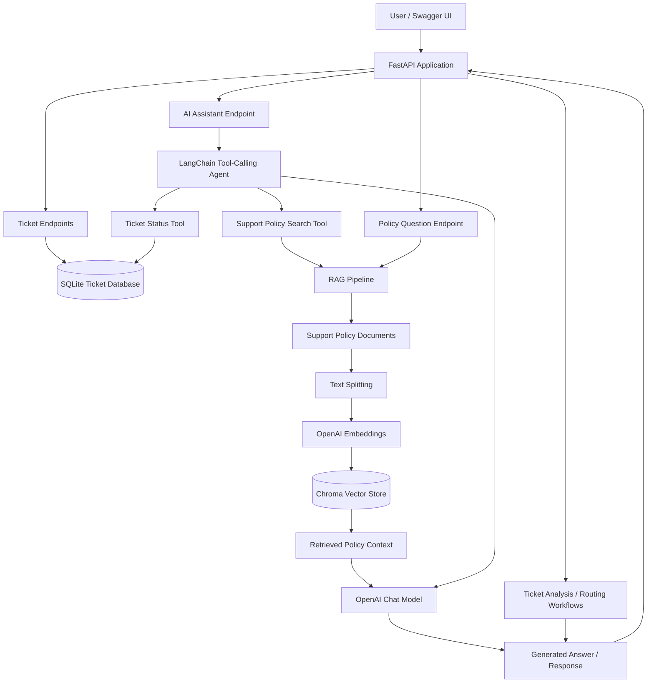
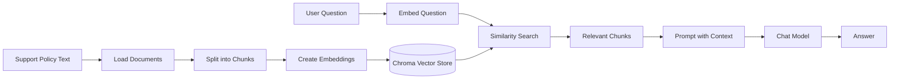

Customer Support AI Helpdesk
An AI-powered customer support backend built with FastAPI, LangChain, OpenAI, SQLite, and ChromaDB. The project combines ticket-management APIs with an AI assistant that can check ticket status and answer questions using support-policy documents.
Project status: Learning project in active development. Some paths, request schemas, and endpoint behavior may differ as the project evolves; use the running FastAPI Swagger UI as the source of truth.

Features
- Ticket management API — create, list, and retrieve support tickets.
- AI ticket assistance — generate a customer-facing response from a ticket description.
- Ticket routing and analysis — run a workflow to analyze and route a support request.
- Retrieval-Augmented Generation (RAG) — retrieve relevant passages from support-policy documents before generating an answer.
- Tool-calling AI assistant — use a LangChain agent that can select tools to:
  - look up a ticket's status in SQLite;
  - search support policies through the RAG pipeline.
- Persistent ticket storage — store tickets in a local SQLite database.
- Interactive API documentation — explore and test endpoints through FastAPI's Swagger UI.
Architecture

How the assistant works
1. A user sends a question to the assistant endpoint.
2. The LangChain agent decides whether a tool is needed.
3. For ticket-status questions, the ticket tool looks up the ticket in SQLite.
4. For policy questions, the policy tool searches the Chroma vector store and retrieves relevant policy content.
5. The model uses the tool result or retrieved context to produce a response.
The model should not be treated as the source of truth for ticket status; the database lookup is the source of truth for that information.
Tech stack
Technology	Purpose
Python	Application language
FastAPI	HTTP API and request validation
Uvicorn	Local ASGI development server
LangChain	LLM workflows, tools, and agent orchestration
OpenAI chat model	AI-generated responses and agent reasoning
OpenAI embeddings	Convert policy text into vectors
ChromaDB	Store and search document embeddings
SQLite	Persist support-ticket records
uv	Python project and dependency management
Swagger UI	Interactive API exploration

Generated database/vector-store files may be created only after you run the application or initialize the RAG pipeline.
Prerequisites
Install the following before running the project:
- Python 3.11 or another version supported by your installed dependencies
- uv
- An OpenAI API key with access to the model and embedding model configured in your code
- Git, if you plan to version-control the project
Check the installations:
python --version
uv --version
git --version
Installation
1. Open the project folder
In PowerShell, change to the directory where the project is stored:
cd "G:\Desktop\Code-Material\GenAI\Basic_Project\customer_support"
If your project is stored elsewhere, replace the path with your own.
2. Install dependencies
If the repository contains pyproject.toml and uv.lock, run:
uv sync
This creates or updates the project's virtual environment and installs the declared dependencies.
If a dependency required by your current code is missing, add it through uv rather than installing it globally. For example:
uv add fastapi "uvicorn[standard]" langchain langchain-openai python-dotenv
Only add other packages when your code imports them and they are not already declared in pyproject.toml.
3. Configure environment variables
Create a local .env file in the project root:
OPENAI_API_KEY=replace_with_your_own_api_key
Use the exact environment-variable names referenced by your code. Never paste your real API key into the README, source files, screenshots, GitHub issues, or commits.
A safe .env.example can contain placeholders:
OPENAI_API_KEY=your_openai_api_key_here
Ensure .env is listed in .gitignore and .env.example is not ignored. If a real key has ever been committed or shared publicly, revoke it and create a replacement.
4. Check local data paths
The application may create local data such as:
- the SQLite ticket database;
- the Chroma vector-store directory.
These are runtime data, not source code. Make sure the relevant parent directories are created by your application or exist before initialization.
Run the application
From the project root:
uv run uvicorn app.main:app --reload
When Uvicorn starts successfully, open:
- Swagger UI: http://127.0.0.1:8000/docs
- OpenAPI schema: http://127.0.0.1:8000/openapi.json
Stop the development server with Ctrl+C.
If the command fails, check that your terminal is in the directory containing app/main.py, that dependencies are installed, and that your .env values are configured.
API endpoints
The following table reflects the endpoint names used during development. Confirm exact methods, paths, and request schemas in /docs, since they can change as the project evolves.
Method	Endpoint	Purpose
POST	/api/v1/ticket	Create a support ticket
GET	/api/v1/ticket	List support tickets
GET	/api/v1/ticket/{ticket_id}	Retrieve a ticket by ID
POST	/api/v1/ask-policy	Ask a question about support policies using RAG
POST	/api/v1/ticket/analyze	Generate an AI-assisted customer response from a ticket description
POST	/api/v1/ticket/route	Analyze and route a support request
POST	/api/v1/assistant	Ask the tool-calling support assistant

Test the API with Swagger UI
1. Start the application.
2. Open http://127.0.0.1:8000/docs.
3. Expand an endpoint.
4. Select Try it out.
5. Enter a request body matching the schema displayed by Swagger.
6. Select Execute and inspect the status code and response.
Swagger UI displays the request schema defined by the current application, so use it instead of assuming a payload from an older README.
Using the AI assistant
The assistant is designed to answer support questions and call tools when appropriate. For example, you can test questions like:
- “What is the status of ticket 1?”
- “What is the refund policy?”
- “What should I tell a customer whose issue is still unresolved?”
Use the actual request schema shown for POST /api/v1/assistant in Swagger UI. The project has used fields such as question and conversation_id; verify the current schema before sending a request.
Available tools
Ticket status lookup
- Queries the ticket repository backed by SQLite.
- Uses the stored ticket record rather than guessing a status.
- Ticket identifiers must match the format accepted by the current tool, such as a numeric ID or TICKET-<id> if that parser is enabled.
Support policy search
- Searches the policy RAG pipeline.
- Retrieves relevant passages from the indexed support-policy documents.
- Supplies retrieved context to the language model to help ground the response.
Tool availability depends on the tools registered in the agent code. The model should not claim that a database or policy lookup succeeded unless the corresponding tool actually ran successfully.
How the RAG pipeline works
Retrieval-Augmented Generation (RAG) gives the language model access to relevant information from your own documents.

At a high level:
1. Load the policy documents.
2. Split the text into smaller chunks.
3. Generate embeddings for the chunks.
4. Store those embeddings in Chroma.
5. Search for relevant chunks when a question arrives.
6. Pass the retrieved context and question to the chat model.
7. Return the generated answer.
If you update a policy document, confirm that your ingestion code re-indexes the changed content. Merely editing the text file may not update an already-built vector store.
Ticket storage
Ticket records are intended to persist in SQLite rather than disappearing when the application restarts.
- The repository layer should handle database operations.
- The service layer should contain application-level ticket logic.
- The API layer should validate requests and return HTTP responses.
- The agent's ticket-status tool should use the repository/service instead of a separate in-memory dictionary.
The database file is generated runtime data and should generally remain out of version control. Do not store real customer information in a public demo database.
Troubleshooting
OPENAI_API_KEY is missing or invalid
- Check that .env is in the project root.
- Confirm that the variable name matches what the code reads.
- Restart Uvicorn after changing environment variables.
- Do not share your API key when asking for help.
Import errors
- Run commands from the project root.
- Check that the module path matches the actual file structure.
- Ensure the imported function is defined in that module.
- Run uv sync after changing dependency declarations.
Chroma or embedding errors
- Confirm the required embedding package is installed.
- Check the API key and model configuration.
- Confirm that the document directory exists and contains the expected files.
- Review whether the vector store has been initialized before searching it.
Ticket not found
- Confirm the ticket exists through the ticket API.
- Use the identifier format accepted by the status tool.
- Confirm that the API and the agent tool use the same SQLite database path.
Mermaid diagram does not render
- Keep the diagram inside a fenced code block labelled mermaid, as shown in this README.
- Preview the file on GitHub after pushing.
- In VS Code, use a Markdown preview extension that supports Mermaid if the built-in preview does not render it.
Security and Git hygiene
Before publishing this project:
- Keep .env and API keys out of Git.
- Ignore local SQLite database files and generated Chroma data.
- Do not commit virtual environments, __pycache__, or local test artifacts.
- Use placeholder values in .env.example.
- Avoid including private customer information in examples.
- Review git status and staged files before every commit.
A starter .gitignore can include:
.env
.env.*
!.env.example

.venv/
__pycache__/
*.py[cod]

*.db
*.sqlite
*.sqlite3
data/chroma_db/

.pytest_cache/
.coverage
Keep pyproject.toml and uv.lock in version control so other developers can reproduce the dependency environment.
Current scope and future improvements
This project is being developed incrementally as a learning exercise. Possible next steps include:
- automated tests for API routes, tools, and the RAG pipeline;
- improved error handling, logging, and configuration management;
- authentication and authorization;
- database migrations and a production database;
- evaluation of RAG answer quality and retrieval relevance;
- persistent conversation state and checkpointing with LangGraph;
- deployment configuration and CI checks.
Conversation memory/checkpointing is not documented as a current feature here; it can be added when the project reaches the LangGraph section.
Learning goals
This project provides hands-on practice with:
- FastAPI routes and Pydantic schemas;
- service/repository separation;
- LangChain prompts, models, tools, and agents;
- document loading, chunking, embeddings, vector search, and RAG;
- SQLite persistence;
- API testing and project organization.
License
Choose and add a license before accepting contributions or publishing the repository for reuse. Until a license is added, do not assume that others have permission to reuse the project.